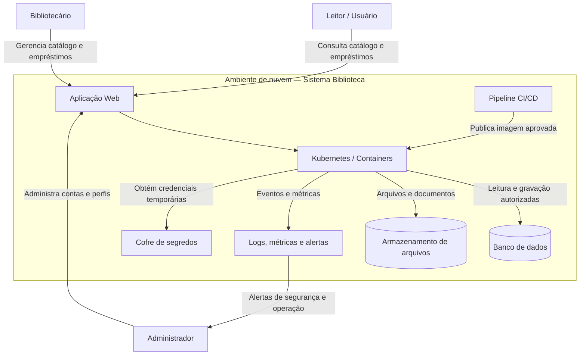

 01 — Diagrama de Contexto

 1. Finalidade

O diagrama apresenta os principais usuários, serviços e componentes que interagem com o Sistema Web de Biblioteca, destacando os limites de responsabilidade e os fluxos de informação.

 2. Diagrama de Contexto

 3. Componentes e responsabilidades

| Componente | Responsabilidade | Proteção necessária |
|---|---|---|
| Leitor/usuário | Consultar catálogo e seus empréstimos | Autenticação e acesso apenas aos próprios dados |
| Bibliotecário | Operações de empréstimo e catálogo | Perfil específico e registro das operações |
| Administrador | Gerenciar contas e configurações | MFA e acesso privilegiado temporário |
| Aplicação Web | Processar solicitações | HTTPS, validação de entrada e controle de sessão |
| Kubernetes/containers | Executar a aplicação | Imagens verificadas, isolamento e atualização |
| Banco de dados | Guardar dados da biblioteca | Rede privada, criptografia e backup |
| Armazenamento | Guardar arquivos | Acesso restrito e criptografia |
| Pipeline CI/CD | Testar e publicar versões | Identidade própria e gates de segurança |
| Cofre de segredos | Fornecer credenciais | Acesso mínimo, rotação e auditoria |
| Observabilidade | Registrar eventos e alertar | Integridade, retenção e acesso controlado |

 4. Dados que precisam de proteção

- Dados cadastrais dos leitores, como nome, e-mail e informações de contato.
- Credenciais e identificadores de sessão.
- Histórico de empréstimos e devoluções.
- Dados do catálogo e documentos armazenados.
- Logs técnicos, que não devem registrar senhas, tokens ou dados pessoais desnecessários.

 5. Principais ameaças

1. Uso indevido de conta administrativa compartilhada.
2. Vazamento de senha do banco ou token do pipeline.
3. Acesso de um leitor aos dados de outro leitor.
4. Imagem de container com vulnerabilidade crítica.
5. Exposição pública indevida do banco de dados.
6. Exclusão ou alteração de registros sem rastreabilidade.

 6. Conclusão

O diagrama evidencia que a proteção deve abranger usuários, aplicação, infraestrutura, dados, pipeline e monitoramento, e não somente a rede.
