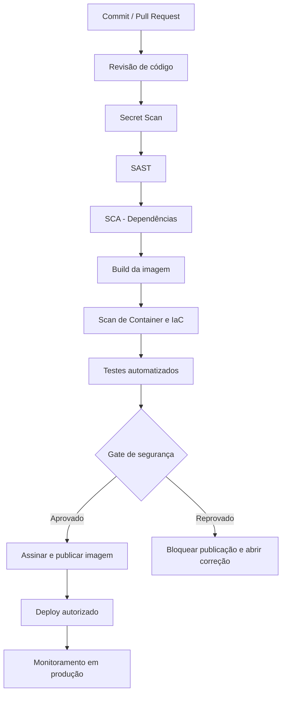

# 04 — Controles de Segurança do Pipeline CI/CD

## 1. Objetivo

Integrar verificações de segurança ao processo de integração e entrega contínuas (CI/CD), identificando problemas antes que uma versão seja publicada.

## 2. Fluxo do pipeline

## 3. Controles por etapa

| Etapa | Controle | Resultado esperado |
|---|---|---|
| Commit/PR | Revisão por outro integrante | Mudanças críticas não entram sem revisão |
| Código | Secret Scanning | Bloquear credenciais expostas |
| Código | SAST | Identificar padrões inseguros sem executar a aplicação |
| Dependências | SCA | Identificar bibliotecas vulneráveis ou desatualizadas |
| Infraestrutura | IaC Scan | Detectar configurações inseguras |
| Imagem | Container Scanning | Identificar vulnerabilidades na imagem |
| Testes | Testes automatizados e DAST em ambiente de teste | Encontrar falhas funcionais e vulnerabilidades em execução |
| Publicação | Assinatura e proveniência do artefato | Permitir verificar origem e integridade |
| Deploy | Aprovação e identidade de serviço | Evitar publicação não autorizada |
| Produção | Logs, métricas e alertas | Detectar comportamento anormal |

## 4. Regras do Gate de Segurança

- Vulnerabilidade crítica confirmada: bloquear publicação até correção ou tratamento formal aprovado.
- Segredo exposto: bloquear imediatamente e exigir revogação da credencial.
- Dependência com risco alto: avaliar exposição e corrigir antes da publicação. Uma exceção exige justificativa, responsável e prazo.
- Falha em teste obrigatório: impedir promoção para produção.
- Toda exceção deve ser documentada, aprovada e possuir data de revisão.

## 5. Proteção do pipeline

- Utilizar identidade própria para o pipeline, sem conta pessoal.
- Conceder somente permissão de publicação no repositório de imagens necessário.
- Proteger a branch principal e exigir revisão.
- Restringir quem pode alterar os arquivos do pipeline.
- Fixar versões de ações e dependências quando possível.
- Não imprimir variáveis secretas nos logs.
- Separar permissões de teste e produção.
- Guardar evidências de execução e aprovação.

## 6. Controle prioritário

Impedir a publicação de imagens com vulnerabilidades críticas ou segredos expostos.

Esse controle reduz a possibilidade de uma falha conhecida chegar ao ambiente de produção.

## 7. Conclusão

A aplicação de controles de segurança no pipeline permite identificar e corrigir vulnerabilidades antes da implantação, tornando o processo de entrega mais seguro e confiável.
